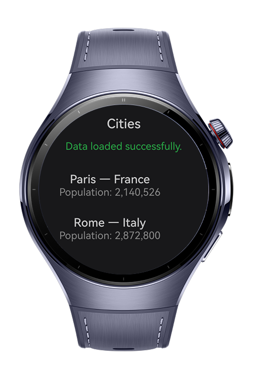

> **Note:** To access all shared projects, get information about environment setup, and view other guides, please visit [Explore-In-HMOS Index](https://github.com/Explore-In-HMOS/hmos-index).

# How To Use Resources And JSON

This codelab demonstrates how to read and display data from both HarmonyOS resource files (string.json, color.json) and
raw JSON files located under the resources/rawfile directory.
It provides a simple yet practical example of data loading, resource management, and UI rendering using ArkTS.

# Preview

<div>    
  
  
</div>

# Use Cases

- Localized UI text management:
  Developers can define all app texts in string.json and access them dynamically in code, ensuring proper i18n and
  maintainability.

- Centralized color handling:
  Colors are stored in color.json and accessed via $r('app.color.xxx'), enabling easy theme customization and design
  consistency.

- Data-driven UI:
  Applications that need to display or process structured data (like lists, catalogs, or configuration files) can load
  content directly from JSON files without requiring a remote API.

- Offline-ready apps:
  This approach is ideal for small apps or demos that work without network connectivity — data is embedded within the
  application package.

- Educational & demo projects:
  Suitable for developers learning ArkTS, resource management, or file I/O in HarmonyOS.

# Tech Stack

- **Languages**: ArkTS, ArkUI
- **Libraries**: @kit.ArkUI, @kit.PerformanceAnalysisKit, @kit.BasicServicesKit

# Directory Structure

```
│   module.json5
│
├───ets
│   ├───common
│   │       ResourceUtils.ets
│   │
│   ├───entryability
│   │       EntryAbility.ets
│   │
│   ├───entrybackupability
│   │       EntryBackupAbility.ets
│   │
│   ├───model
│   │       City.ets
│   │
│   └───pages
│           Index.ets
│
└───resources
    ├───base
    │   ├───element
    │   │       color.json
    │   │       float.json
    │   │       string.json
    │   │
    │   ├───media
    │   │       background.png
    │   │       foreground.png
    │   │       layered_image.json
    │   │       startIcon.png
    │   │
    │   └───profile
    │           backup_config.json
    │           main_pages.json
    │
    ├───dark
    │   └───element
    │           color.json
    │
    └───rawfile
            cities.json

```

# Constraints and Restrictions

## Supported Device

* Huawei Watch 5

# License

**How To Use Resources And JSON** is distributed under the terms of the MIT License
See the [LICENSE](./LICENSE) for more information.